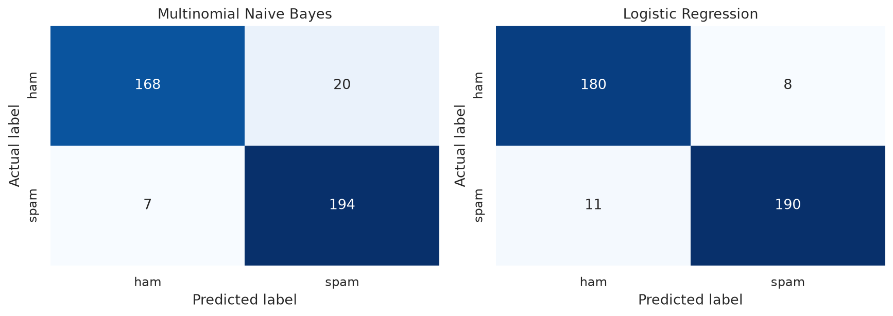

# CSCI461 Assignment 1 — Dockerized YouTube Spam Analysis

**Nile University · Introduction to Big Data · Fall 2026 · Team assignment**

An end-to-end, reproducible study of spam and ham comments using approved dataset
**3, UCI YouTube Spam Collection**. The notebook covers data cleaning, sampling,
text analysis, two TF-IDF classifiers, and K-Means, entirely inside Docker.

- **Repository:** https://github.com/lBebol/csci461-assignment-1
- **Notebook:** [`notebook/analysis.ipynb`](notebook/analysis.ipynb), including executed outputs
- **Rubric map:** [`docs/REQUIREMENTS.md`](docs/REQUIREMENTS.md)
- **Team discussion guide:** [`docs/DISCUSSION_GUIDE.md`](docs/DISCUSSION_GUIDE.md)
- **Team verification:** [`docs/TEAM_VERIFICATION.md`](docs/TEAM_VERIFICATION.md)

## Measured results

The raw corpus contains 1,956 comments from five videos. Remove 3 duplicate
records and 8 comments with no text remaining after normalization, leaving
**1,945 usable comments**. Missing dates are retained as unknown metadata.

The fixed, stratified **text-group-disjoint** split contains 1,556 training and
389 test records. Identical cleaned messages never cross the split. TF-IDF is
fitted only on training text; classifiers share the same holdout.

| Model | Accuracy | Spam precision | Spam recall | Spam F1 | Macro F1 |
|---|---:|---:|---:|---:|---:|
| Majority baseline | 0.5167 | — | — | — | — |
| Multinomial Naive Bayes | 0.9306 | 0.9065 | 0.9652 | 0.9349 | 0.9303 |
| Logistic Regression | **0.9512** | **0.9596** | 0.9453 | **0.9524** | **0.9511** |

K-Means selects **k=6** from candidates 2–6, with silhouette **0.1280** and
adjusted Rand index **0.0507** against known labels. Its themes include view
counts, subscription requests, cross-video promotion, mixed music/promotion,
song opinions, and fan affection. Low separation and a large mixed cluster are
important findings: these clusters are not a substitute for spam classification.
105 records have no retained clustering vocabulary and are explicitly marked
`cluster=-1`; 1,840 records receive substantive cluster assignments.

These are results from one holdout of an older, curated five-video corpus, not a
claim of real-world platform accuracy. Near-duplicates and shared authors/videos
can still cross the holdout boundary. k=6 is the best **tested** candidate, not an
established global optimum. See the notebook for interpretation and limitations.



## Project structure

```text
bd-a1/
├── Dockerfile
├── requirements.txt
├── README.md
├── data/
│   ├── dataset.csv
│   ├── SOURCE.json              # Source URL, citation, checksums
│   └── README.md
├── notebook/
│   └── analysis.ipynb
├── output/
│   ├── cleaned_data.csv
│   ├── model_metrics.txt
│   ├── cluster_summary.txt
│   ├── run_summary.json
│   ├── test_predictions.csv
│   ├── text_insights.md
│   ├── figures/                 # Eight saved PNG figures
│   └── evidence/                # Actual Docker/reproduction logs
├── screenshots/
├── scripts/                     # Download, execute, verify, package
└── docs/                        # Rubric, discussion, team verification
```

Additional CSVs record sampling distributions, model comparisons, and the k
experiment. The command-line runner also writes `output/analysis.executed.ipynb`.
All final analysis artifacts are under `output/`; screenshots have their own
required directory.

## 1. Get the project on the host

Prerequisites: Docker Engine or Docker Desktop running, Git, and a browser.
The commands below use Bash (Linux, macOS, or WSL). Host Python 3 is needed only
for the optional download, verification, or ZIP scripts; analysis dependencies
are installed in the image.

```bash
git clone https://github.com/lBebol/csci461-assignment-1.git bd-a1
cd bd-a1
mkdir -p output/figures
```

The dataset is included under its CC BY 4.0 license. No Kaggle credentials or NLP
downloads are needed. For exact source/citation/license details, see
[`data/README.md`](data/README.md). To reconstruct it from the official archive:

```bash
python3 scripts/download_data.py
```

**Host-first preparation:** the initial commit prepared an empty notebook and
dataset on the host, then built `csci461-a1:scaffold`. Subsequent host edits added
the analysis and the final image was rebuilt. The Git history and author-machine
Docker evidence preserve this sequence. On a clone, the completed analysis files
already exist on the host before building; do not create them only inside a
running container.

## 2. Build the custom image

```bash
docker build --progress=plain -t csci461-a1:latest .
docker images csci461-a1
```

The Dockerfile uses the required `quay.io/jupyter/scipy-notebook:latest`, creates
`/home/jovyan/bd-a1`, sets `WORKDIR`, installs the pinned `requirements.txt`, and
copies the dataset, notebook, scripts, and documentation into the image. The
base is several GB; the first download is much larger than this repository.

The base digest used for the submitted run was:

```text
quay.io/jupyter/scipy-notebook@sha256:2479174ae36ec84373f3c352cb6d5801382c0aa6642e739f04bea409f6cedae1
```

The mandated `latest` tag can change. Pinned analysis packages and the recorded
base digest document this run; the published final image digest, once available,
identifies the exact distributed environment.

## 3. Start JupyterLab and run the notebook

```bash
docker run -d --name csci461-a1 \
  -p 127.0.0.1:8888:8888 \
  --mount type=bind,src="$(pwd)/output",dst=/home/jovyan/bd-a1/output \
  --mount type=bind,src="$(pwd)/notebook",dst=/home/jovyan/bd-a1/notebook \
  csci461-a1:latest
docker logs csci461-a1
```

Open the `http://127.0.0.1:8888/lab?token=...` URL printed in the logs. Open
`notebook/analysis.ipynb`, choose **Kernel → Restart Kernel and Run All Cells**,
confirm the dialog, wait for the final `SUCCESS` message, and save the notebook.
The notebook has 31 cells, including 15 code cells, and asserts that it is running
inside a container. Its executed outputs are included for convenient review.

The `output/` bind mount persists CSVs, metrics, and figures on the host. The
separate `notebook/` mount saves UI edits and execution outputs back to the host.
On Linux, these directories must be writable by the image user (UID 1000 in the
tested environment). If port 8888 is already in use, use
`-p 127.0.0.1:8889:8888` and browse to host port 8889 instead.

### Image, container, ports, and mounts

- An **image** is a reusable filesystem/configuration template built from the
  Dockerfile. A **container** is a running or stopped instance of that image.
- In `-p 8888:8888`, the left side is **HOST_PORT** and the right side is
  **CONTAINER_PORT**. The host browser connects to the host port; Docker forwards
  traffic to Jupyter on container port 8888. Our command additionally binds the
  host side to `127.0.0.1`.
- A **bind mount** maps an explicit host directory into the container. A named
  **volume** is storage managed by Docker. This assignment uses a bind mount so
  files are directly accessible in the host project.
- Container-local edits are not automatically image updates. Save changes to the
  host and rebuild the image before distributing the final version.

## 4. Command-line execution and independent artifact checks

This uses the notebook **embedded in the image**, mounts only output, starts a
fresh kernel, and disables container networking. It therefore does not rely on
host-installed analysis packages, a host notebook mount, or remote datasets.

```bash
docker run --rm --network none --no-healthcheck \
  --mount type=bind,src="$(pwd)/output",dst=/home/jovyan/bd-a1/output \
  csci461-a1:latest python scripts/run_analysis.py
```

The runner executes all cells, saves `output/analysis.executed.ipynb`, then checks
original-text preservation, disjoint text groups, held-out predictions against
reported metrics, cluster counts, required files/figures, and sequential execution.
`--no-healthcheck` is used only for this batch job: the base image's health check
expects a running Jupyter server, whereas this command runs a notebook and exits.

For a full **fresh empty output directory → execute → compare → remove container
→ verify output persistence** check, run on the host:

```bash
python3 scripts/verify_reproduction.py --image csci461-a1:latest
```

**Verified:** nine deterministic artifacts matched the reference output byte-for-byte,
and their host files remained unchanged after the verification container was removed.
The check records its actual result in `output/evidence/reproduction.json` and
`reproduction.log`. This is author-machine reproducibility evidence; a separate
teammate pull/run is still required by the handout.

## 5. Container lifecycle and evidence

With the Jupyter container running:

```bash
docker images csci461-a1
docker ps --filter name=csci461-a1
docker ps -a --filter name=csci461
docker logs csci461-a1
docker inspect csci461-a1
python3 scripts/capture_docker_evidence.py
```

The capture script saves real command output in `output/evidence/docker_all.log`,
redacting ephemeral Jupyter login tokens. Required screenshots are under
[`screenshots/`](screenshots/). To demonstrate stopped-container state and cleanup:

```bash
docker stop csci461-a1
docker ps -a --filter name=csci461-a1
docker rm csci461-a1
ls output/cleaned_data.csv output/model_metrics.txt output/cluster_summary.txt
```

Host files remain because they were bind-mounted. To reopen Jupyter after removal,
repeat the run command in section 3. If only stopped, `docker start csci461-a1`
reuses the existing container.

## 6. Docker Hub distribution

**Publication status: awaiting Docker Hub authentication.** The local image is
built and the workflow is implemented; a pushed image is not yet claimed.

Authenticate, set your actual username, and tag/push the final custom image:

```bash
docker login
export DOCKERHUB_USER=your_actual_dockerhub_username
docker tag csci461-a1:latest "$DOCKERHUB_USER/csci461-assignment-1:fall2026-v1"
docker push "$DOCKERHUB_USER/csci461-assignment-1:fall2026-v1"
docker image inspect "$DOCKERHUB_USER/csci461-assignment-1:fall2026-v1" \
  --format '{{json .RepoDigests}}'
```

Record the actual repository, tag, and digest here after a successful push. Docker
Hub is the **registry**; `username/csci461-assignment-1` is the **repository**;
`fall2026-v1` is the **tag**. A content digest identifies the exact image.

**Another teammate must pull the published image and run it successfully.** Exact
commands and the evidence record are in
[`docs/TEAM_VERIFICATION.md`](docs/TEAM_VERIFICATION.md). That check is explicitly
pending until a teammate performs it; local tests do not substitute for it.

## 7. Submission ZIP and team discussion

From the project root:

```bash
python3 scripts/package_submission.py
```

This creates `../csci461-assignment-1.zip` with one `bd-a1/` root, all required
project files, the redistributable dataset, outputs, documentation, and screenshots.
A SHA-256 sidecar is also written. Git metadata, caches, and credentials are excluded.

Before submission, add the actual 3–4-student roster and the independent teammate
verification record. Each member should rehearse the entire
[discussion guide](docs/DISCUSSION_GUIDE.md), including Docker and machine learning.

The public GitHub repository covers the listed GitHub bonus; comparing two
classifiers covers the model-extension bonus. The handout's cover says +2 bonus,
but its detailed section allocates +1 total; both explicitly listed activities
are implemented.

### Editing

Edit the notebook directly in JupyterLab, save, rerun, and rebuild before publishing.
Alternatively, `scripts/build_notebook.py` is its readable source generator:
editing that file and running it **replaces the notebook and clears outputs**.
Use one editing route at a time and rerun the complete notebook after changes.
